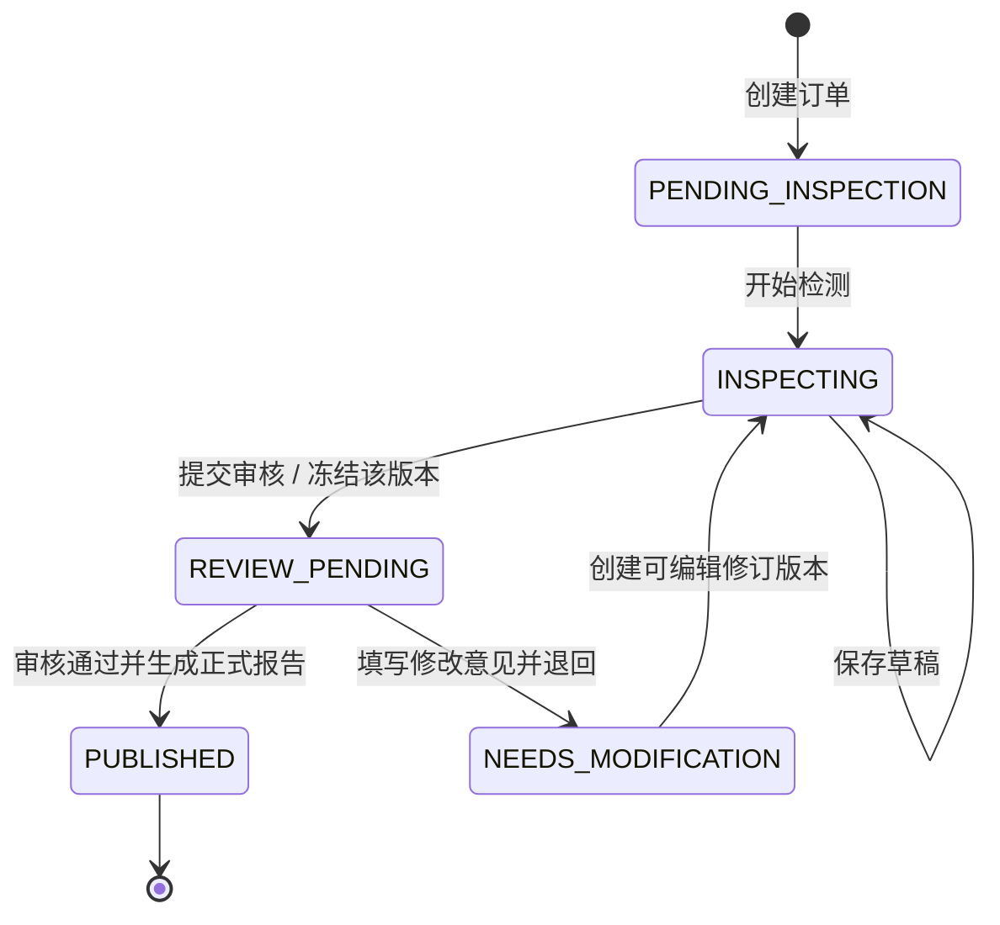

# 鉴见车辆检测 SaaS 平台技术规格说明

> 文档性质：产品需求、交互、架构和验收规格  
> 版本：1.0  
> 项目：面向多家车辆检测机构的乘用车 / 摩托车检测平台  
> 原型参考：本工作区现有“鉴见 · 车辆检测工作台”交互原型  
> 目标读者：产品、设计、前端、后端、测试、运维与信息安全人员

---

## 1. 文档目的与实施原则

本文把当前交互原型和业务需求转化为可交付开发的技术规格，覆盖：

- 检测师微信小程序端；
- 委托人无需注册即可访问的报告分享页；
- 检测机构管理后台；
- 平台运营后台；
- 多租户数据模型、角色权限、可变检测模板、检测版本与审核；
- 现场照片采集、快速加载和公开访问安全；
- 第三方车辆信息查询适配边界；
- 接口、测试、部署、安全与验收约束。

实施时必须遵守以下原则：

1. **以后台返回的模板版本为检测清单真相来源。** 前端不能固化某一种唯一的车辆检测表单。
2. **检测提交是版本化、可审计的业务事件。** 审核中的版本不可被静默修改；退回后创建新的可编辑修订版本。
3. **租户隔离必须由后端强制实现。** 不能以隐藏菜单、前端筛选或不可猜的 ID 代替租户隔离。
4. **正式报告和检测草稿分离。** 未审核通过的内容不能被报告分享页读出。
5. **分享链接不等同于公开订单 API。** 使用高熵访问令牌、期限和撤销机制，公开接口仅返回经过核准的报告字段。
6. **实际现场图片与示意图严格区分。** 原型内 SVG 仅为装饰插图，不能作为车辆取证图片、正式报告证据或标准配图。
7. **标准内容逐版本人工核验。** 当前原型中的示例项目不构成完整标准清单、评估结论或合规规则。
8. **小程序端采用渐进上传和低带宽设计。** 图片可见不应依赖下载原图。

---

## 2. 范围、版本目标与未包含事项

### 2.1 首期交付范围

首期包含：

- 平台开通检测机构并创建首个机构管理员；
- 机构管理员管理机构资料、成员、角色、权限、品牌 Logo、审核人及检测模板；
- 检测师在小程序选择乘用车/摩托车、业务类型、套餐并创建订单；
- 动态加载模板章节和检测项，逐项录入结果、说明与现场照片；
- 保存草稿、恢复未提交检测、提交审核、查看审核状态；
- 机构审核人员审阅检测版本、照片和异常项，通过或附意见退回；
- 退回后按审核意见重新编辑并再次提交；
- 审核通过时生成不可变正式报告版本；
- 检测师将正式报告链接分享给委托人；委托人无需注册或登录即可只读查看；
- 订单、审核记录、报告、图片访问和用户关键操作留痕；
- 平台后台对机构、平台账号和基础运营数据进行管理；
- 车辆信息查询第三方接口的服务端适配层和可关闭的接入点。

### 2.2 首期不包含

除非单独立项，首期不默认包含：

- 委托人账号、登录、订单中心、用户评论或用户个人信息管理；
- 检测报告付费解锁；
- 自动估价、交易撮合、维修报价或车辆价值承诺；
- 自动视觉识别并直接形成专业检测结论；
- 原型示范检测项目直接声明为法定、国标或团标完整检查项；
- 小程序内订阅支付、自动续费、发票、复杂分账与渠道结算；
- 多语言、境外监管要求或多地域灾备；
- 将第三方 API 密钥放入小程序包或浏览器代码；
- 在未落实机构标准文本的情况下生成真实评估评级。

### 2.3 界面范围

| 产品端 | 主要用户 | 页面 / 功能 |
|---|---|---|
| 微信小程序 | 检测师 | 登录与机构加入、首页、车辆查询、创建订单、模板选择、现场检测、订单、审核状态、我的、历史报告、报告分享 |
| 微信小程序 | 检测师 | 登录与机构加入、首页、车辆查询、创建订单、模板选择、现场检测、订单、审核进度、我的、历史报告、报告分享 |
| 微信小程序 / 机构管理后台 | 机构管理员 | 机构信息、Logo、成员、检测模板、待审核队列、订单、正式报告、公开分享管理、日志；可审核、退回和发布报告 |
| 平台运营后台 | 平台运营、平台超级管理员 | 机构入驻和停用、初始管理员开通、平台账号、套餐/配额、全平台状态与审计；禁止默认查看机构检测照片和完整报告正文 |
| 报告只读 H5 | 委托人 | 使用分享令牌查看已发布报告、已公开照片、机构信息、适用范围说明；无需用户注册 |

---

## 3. 产品结构和导航

### 3.1 检测师端导航

移动端使用底部导航，建议入口：

1. **首页**：乘用车检测、摩托车检测入口、车辆查询、今日任务、最近订单。摩托车入口目前关闭并提示“正在建设中，敬请期待”，不可创建新订单；已有摩托车订单仍可访问和处理。
2. **订单**：检测订单列表、筛选、状态、进入继续检测或查看详情。
3. **审核**：检测师只能看到自己提交报告的待审核/退回/已发布进度；机构管理员看到机构待审核队列并执行审核。
4. **我的**：个人资料、机构工作空间、历史报告、消息、帮助与退出。

在首页或创建流程中提供：

- 乘用车 → 进入独立的完整订单创建页，依次完成“选择标准 → 选择检测类型”；标准选择页提供“按国家标准配置的检测模板”和“按团体标准配置的检测模板”两个入口；选择可用检测类型后立即创建订单并进入现场检测，不再展示方案确认页。检测类型页提供三非排查、四非排查、整车检测、新车检测，以及显示“正在建设中，敬请期待”且不可继续的新能源检测入口；
- 摩托车 → 首页入口暂时禁用并显示“正在建设中，敬请期待”；不得通过该入口创建新摩托车订单。已有摩托车订单及其报告仍可按权限查看和处理。
- 检测项配置/模板预览入口；
- 车架号 / 车牌查询入口（未接通前显示接口未配置或演示提示，不得谎称查询成功）。

### 3.2 机构后台导航

- 工作概览；
- 检测订单；
- 待审核 / 审核记录；
- 检测模板；
- 机构报告与分享链接；
- 成员与角色；
- 机构资料与 Logo；
- 车辆查询集成配置（仅管理员）；
- 操作审计和数据导出（按权限开放）。

### 3.3 平台后台导航

- 机构列表、入驻申请、机构详情、停用/恢复；
- 机构首个管理员账号开通或邀请；
- 平台套餐、试用期、到期日、机构配额；
- 平台工作人员与平台权限；
- 服务健康状态及全局审计；
- 不跨机构浏览敏感检测内容，除非具备明确授权、工单和审计目的。

---

## 4. 视觉与交互复刻规格

### 4.1 原型视觉语言

- 品牌名：**鉴见**；品牌辅助英文：`INSPECTION STUDIO`。
- 品牌关键词：可信赖、克制、现场专业、清晰留痕；避免沿用竞品深蓝渐变报告配色和布局。
- 主背景：暖浅灰绿；卡片：白；品牌深色：深青绿；主操作：森林绿；强调色：浅青柠绿；状态颜色使用互补的蓝、琥珀、砖珊瑚和绿色。
- 首页欢迎横幅采用深青绿渐变、简洁轨道图形；车辆类型入口分别采用浅苔绿和浅灰青底。
- 信息层级：小号英文 section 标识、清晰中文标题、短描述、功能卡片和低对比说明。
- 报告封面采用深青绿、品牌标记、报告编号、机构 Logo 和几何章；正文以章节序号、信息表、检测结果、现场影像、免责声明组成。
- 原型中车辆矢量图仅为视觉装饰，生产界面必须使用车辆真实照片、真实标准附件图（获得合法使用授权后）或清晰的“示意图”占位图。

### 4.2 页面布局规则

- 桌面后台：固定左侧深色导航（原型宽度 248 px）、顶部机构/页面面包屑、居中主内容区；表格与卡片自适应可用宽度。
- 手机：底部导航、安全区适配、单列内容、弹出底部操作单；编辑检测项时避免过窄的多列表格。
- 桌面下限建议 1024 px；小程序设计基准 375 px 宽；适配 320–480 px 设备。
- 重点操作按钮触达面积不小于 44 × 44 CSS px（小程序对应设计稿 dp）。
- 手机端禁用横向滚动整个页面；表格在移动端转为卡片或只显示关键信息。
- 弹窗支持遮罩点击关闭（确认型流程除外）、关闭按钮、Esc（Web）和系统返回（小程序）。
- 提交、退回、发布、禁用分享等操作均提供确认和清晰反馈；请求中显示防重复提交状态。

### 4.3 设计 Token（初始值，可在设计系统中统一）

以下为对原型样式的设计意图提炼；实现时使用 CSS/小程序主题变量，不得散落硬编码：

| Token | 初始值 / 语义 |
|---|---|
| `color-brand-900` | `#172E39` 深色导航 |
| `color-brand-800` | `#203B42` 报告封面 |
| `color-primary` | `#376D57` 主按钮 |
| `color-primary-deep` | `#264C40` 品牌深绿 |
| `color-accent` | `#D7ED9F` 浅青柠强调 |
| `color-canvas` | `#F5F7F5` 页面背景 |
| `color-surface` | `#FFFFFF` 卡片 |
| `color-text` | `#23343E` 正文 |
| `color-text-muted` | `#8D999C` 次要文案 |
| `color-line` | `#E9EDEB` 分隔线 |
| `color-warning` | `#BD8851` 待审核 / 注意 |
| `color-return` | `#C87861` 退回 / 异常 |
| `color-success` | `#64866D` 通过 / 已完成 |
| `radius-card` | 10–13 px |
| `radius-control` | 6–8 px |
| `shadow-card` | 低对比、约 `0 12px 40px rgb(34 52 62 / 5%)` |

状态不能仅依靠颜色区分；同时显示中文标签和状态图标。

---

## 5. 用户角色、租户与权限模型

### 5.1 租户生命周期

1. 平台运营创建或审核通过一家检测机构（`tenant`）。
2. 平台只为该机构开通/邀请一个**机构管理员**（首个租户管理员）。
3. 管理员首次登录后维护机构资料、Logo、员工，并为成员分配检测师或机构管理员两种角色之一。
4. 员工只能看到所属租户授权的订单、检测模板和报告。
5. 机构暂停、到期或停用后，租户认证和 API 按平台策略拒绝；历史数据依保留政策只读保留。
6. 员工离职时停用其账号及会话，不删除已签署/审计的检测记录。

### 5.2 角色定义

| 角色 | 建立者 | 默认能力 |
|---|---|---|
| 平台超级管理员 | 系统初始化 | 管理全平台和租户；高危操作二次确认并全部审计 |
| 平台运营 | 平台超级管理员 | 机构入驻、状态、配额和服务支持；敏感内容默认无权读取 |
| 机构管理员 | 平台开通 | 管理本租户资料、成员、角色、模板、Logo、审核配置和分享策略 |
| 检测师 | 机构管理员 | 创建订单、执行检测、上传照片、提交和修改被退回的订单、查看本人报告进度；不能审核、退回或发布 |

机构业务角色限定为“机构管理员”和“检测师”两种，不提供审核员、报告管理员或自定义子角色。管理员管理机构成员并分配上述角色；权限仍需由服务端基于角色和租户上下文校验。

### 5.3 RBAC 权限点示例

```text
tenant.read / tenant.update / tenant.brand.update
member.read / member.invite / member.disable / role.manage
template.read / template.create / template.update / template.publish
order.create / order.read.own / order.read.tenant
inspection.edit.own / inspection.submit / inspection.resubmit
review.queue.read / review.approve / review.return
report.read.own / report.read.tenant / report.share.create / report.share.revoke
vehicle.lookup
audit.read
platform.tenant.manage / platform.subscription.manage
```

机构管理员不得批准自己作为检测师提交的同一个检测版本；应由另一位机构管理员完成复核并写入审计。

### 5.4 强制租户隔离

- 所有租户业务表都带 `tenant_id NOT NULL`，包含复合索引和外键条件。
- 后端从已验证的身份/会话解析 `tenant_id`，不信任客户端请求体或 URL 中的租户 ID。
- 查找、写入、统计、导出、后台任务、对象存储路径、缓存键均纳入租户上下文。
- 数据访问接口必须对租户范围做服务端过滤；建议数据库行级安全策略（RLS）作为纵深防护。
- 用户可属于多个机构时，通过独立 membership 管理当前工作空间；切换工作空间后重发/刷新短期令牌，并再次执行权限检查。
- 公共分享读取由独立服务路径实现：令牌只映射一个已发布报告版本，只返回经过字段白名单处理的内容。

---

## 6. 业务流程与状态机

### 6.1 订单与检测工作流



界面状态映射：

| 后端状态 | 界面文案 | 说明 |
|---|---|---|
| `PENDING_INSPECTION` | 待检测 | 订单已建，尚未开始记录 |
| `INSPECTING` | 检测中 | 当前可编辑草稿版本 |
| `REVIEW_PENDING` | 待审核 | 已提交的版本锁定 |
| `NEEDS_MODIFICATION` | 待修改 | 退回意见必填，旧提交版本保留 |
| `PUBLISHED` | 已完成 | 审核通过，存在正式报告版本 |
| `CANCELLED` | 已取消 | 仅符合机构策略时允许；记录取消人和原因 |

`已完成`是业务单据的完成状态；正式报告版本有独立的 `report_status`，不可只根据前端按钮推断其是否可分享。

### 6.2 创建订单

1. 选择车辆种类：乘用车 / 摩托车。
2. 乘用车在独立页面依次选择检测标准（国标 / 团标）和检测类型（三非排查、四非排查、整车检测、新车检测），选择可用类型后立即创建订单并进入现场检测；不设置检测方案确认步骤。新能源检测入口显示建设中提示并禁止创建；摩托车按摩托车类型与机构配置规则选择。
3. 乘用车标准页以两个清晰入口呈现“按国家标准配置的检测模板”和“按团体标准配置的检测模板”；点击后进入检测类型页，不使用弹窗承载标准和类型选择流程。
4. 检测类型页按卡片展示各类套餐及对应模板的检查项/章节数；新能源检测卡片显示“正在建设中，敬请期待”且禁用进入，机构未配置的其他类型仍需明确显示“暂未配置/暂不可用”，不得静默切换至另一标准或业务类型。
5. 选择检测类型后，系统按所选标准及准确匹配的已发布模板立即创建订单并进入现场检测；不得出现单独的检测方案确认步骤。
6. 检测章节页面不展示车辆资料录入框，包括车牌、首次上牌、表显里程、车型等；车辆资料应在订单创建或其他车辆资料界面维护，不在逐项检测过程中编辑。
7. 可选关联委托资料；首期不要求委托人账号。
8. 后端生成不可复用的订单编号，固定 `tenant_id`、创建人、当前模板修订版和标准修订版快照，状态为 `PENDING_INSPECTION`。
9. 订单创建幂等；重复网络提交不得生成重复订单。

#### 创建页面响应式要求

- 桌面端创建流程使用完整页面，不以模态弹窗替代页面导航；保留返回上一步、取消创建和当前步骤状态。
- 移动端标准选择使用纵向卡片；检测类型采用易触达的单列卡片，卡片间距、标题、检测项摘要和操作箭头清晰可辨。
- 页面宽度适配 320–480 px；标题、取消按钮、步骤指示器和卡片不得互相挤压或产生横向滚动。
- 底部操作按钮及页面末尾说明应避开手机固定底部导航和安全区，确保可滚动触达。
- 业务流程语义和模板映射在桌面及移动端保持一致；只改变布局，不改变套餐内容和创建行为。

### 6.3 现场检测

- 每个订单只使用创建时锁定的 `template_revision_id`，管理员后来更新模板不改写正在执行的订单。
- 检测界面按模板章节分组，不相关项目不得混入本套餐。
- 检测项支持单选、单选带说明、多选、数值、文本、日期、照片、附件等按模板配置的字段类型。
- 对每项保存：结果、说明、操作人、操作时间、所用选项、备注、证据照片和变更历史。
- 模板可要求项目必填、异常必填说明、异常至少 N 张照片、指定拍摄角度/照片分类、允许“不适用/无法判定”及相应理由。
- 表单采用草稿保存，支持断网本地暂存和重新联网同步；同步冲突不能静默覆盖，服务端返回版本冲突后展示可恢复草稿/重新加载。
- 现场图片应显示上传状态：待上传、上传中、已上传、失败待重试；检测版本不能在要求上传的证据仍未成功上传时提交。

### 6.4 提交审核

服务端提交时应一次性校验：

1. 用户当前仍有本订单的编辑权限且所属租户匹配；
2. 订单处于允许提交的状态；
3. 所有模板必填项都有合法结果；
4. 异常、未知和不可判定项满足所需理由、照片和说明规则；
5. 所有必需照片已经上传并通过文件校验；
6. 模板/标准修订版仍可被该订单引用；
7. 请求携带的草稿版本号与服务端当前版本一致。

通过后在事务内生成不可变 `inspection_revision`，将订单状态变成 `REVIEW_PENDING`，写入提交人、提交时间、内容哈希和审计记录。该版本不得由检测师或管理员直接改写。

### 6.5 机构审核

- 仅机构管理员可以审阅同一租户的待审版本；检测师只能查看本人报告进度。
- 列表支持提交时间、车型、检测师、套餐、状态筛选。
- 审核详情至少显示车辆资料、模板版本、标准依据、检查项、异常项目、全部照片、检测师和提交时间。
- **审核通过**：仅机构管理员可执行。原子化生成正式报告版本、记录审核人和时间、更新订单为 `PUBLISHED`，发布后内容不可被后台悄悄编辑。修正正式报告必须按“撤销/作废并创建新版本”处理。
- **退回**：仅机构管理员可执行；必须有非空、可读、明确的退回原因；可关联一个或多个检查项；记录审核人、退回时间和目标修订版本。
- 退回后检测师可从最新修订副本编辑；再次提交生成新的不可变审核版本；历史版本和审核意见始终可查。
- 审核人操作应具备幂等键并防止并发的重复批准/重复生成报告。

### 6.6 分享与撤销

- 只允许 `PUBLISHED` 且未被作废的报告创建公开分享令牌。
- 分享 URL 不得使用可遍历的订单 ID 作为授权秘密；使用服务端生成的高熵随机令牌（不少于 128-bit 熵），数据库只存令牌哈希。
- 可配置到期时间、查看范围、密码/验证码策略、访问次数限制（如适用）及撤销。
- 默认返回脱敏车辆信息；是否公开完整车牌、VIN、检测人员姓名、委托资料，由机构管理员按租户策略配置。
- 公共端没有用户账户，不可写评论、修改报告或列出同机构其它报告。
- 分享页应支持 H5 URL。微信内分享同时提供小程序 `path`/短链能力；若未完成微信公众平台关联域名与分享审核，不得宣称已支持微信外打开。
- 公开页面只读、带“报告版本/签发机构/出具时间/免责声明”，撤销或过期后返回统一的不可用页面。

---

## 7. 动态检测模板与标准管理

### 7.1 模板层级

```text
检测标准 (Standard)
  └── 标准发布版本 (StandardRevision)
       └── 检测模板 (Template)
            └── 模板修订版 (TemplateRevision)
                 ├── 章节 (TemplateSection)
                 └── 项目定义 (TemplateItem)
                      ├── 字段定义 / 选项 / 校验规则
                      └── 照片要求
```

模板需要包含：

- 机构 `tenant_id`（平台共享标准模板可另行使用平台模板类型）；
- 适用车辆种类、车辆新旧类型、适用业务和标准版本；
- 套餐显示名、说明、排序、启用/停用状态；
- 章节顺序、章节说明、章节层级；
- 检查项 ID、编号、标题、提示、判定依据、回答类型和候选值；
- 检查项可配置独立候选值集；如选择项触发条件规则，需将主选项、尺寸/分级补充值和派生判定分别保存，未完成依赖字段时不得视为已完成；
- 异常规则、必填规则、照片数量/类型/质量要求和移动端展示顺序；
- 检查项是否影响摘要/评级的规则；未经专业审核不得推断性地自动计分；
- 模板修订状态：草稿、待专业审核、已发布、停用；
- 发布者、审核者、版本号和生效日期。

检查项 schema 必须支持模块化扩展和模块就绪状态。模块可以是“待配置”，但不得伪造其检查项；检测界面需明确展示待配置模块，相关模板在所有必需模块发布前不可提交审核。检测答案应保留所选选项及条件判定字段，不应把派生结论覆盖到原始选项值。

### 7.2 初始套餐目录（产品种子，不是正式标准清单）

| 车辆与业务 | 初始套餐 |
|---|---|
| 乘用车 | 三非排查、四非排查、整车检测、新车检测、新能源检测；上述每种类型均可分别配置国标和团标模板 |
| 摩托车二手车 | 整车检测（摩托车二手车鉴定评估技术规范） |
| 摩托车二手车 | 整车检测（团标检） |

国标 / 团标选择后均须展示相同的五种乘用车业务类型。某机构尚未发布对应模板时，入口仍应展示并明确提示“未配置”，不可静默改用其他标准模板。新车和新能源项目必须以机构审核发布的适用模板为准；示例清单不代表标准原文中的完整检查要求。

当前团标整车检测原型模块及状态：

| 模块 | 状态 | 已配置内容 |
|---|---|---|
| 漆面覆盖 | 已配置 | 19 个车身覆盖件，按塑料件/金属件区分选项并分别以黑色/绿色显示；项目次序不变 |
| 重大事故检测 | 已配置 | 59 个结构/安全项目，分为 31 个非关键决定项和 28 个关键决定项；各项目按细则配置选项，关键项非正常结果需作 30cm×30cm 尺寸判定，大于阈值触发事故车提示 |
| 泡水检测 | 已配置 | 29 个项目；五个重点项目选择“水渍泥沙”时必填情况说明，五项中累计三项及以上触发泡水车提示 |
| 火烧检测 | 已配置 | 8 个项目；烧蚀、熏黑碳化、炙烤融化任一选项触发火烧车提示 |
| 全车玻璃 | 已配置 | 12 个项目；角玻璃、天窗玻璃及其他玻璃按配置提供“未配备” |
| 内饰检测 | 已配置 | 24 个项目；按项目配置磨损、破损、划伤、更换、拆卸、修复、改装、缺失、水渍、未配备等选项 |
| OBD系统诊断 | 已配置 | 5 个项目，分别提供“无故障码 / 有故障码” |
| 车辆里程数读取 | 已配置 | 6 个项目提供“数据正常 / 异常数据”；历史云端、其他、维保记录另提供“此项检测无此服务” |
| 发动机及变速箱检测 | 已配置 | 8 个项目，发动机机爪胶支持自定义车况及必填说明 |
| 底盘检查 | 已配置 | 10 个项目，包含制动部件、减震器、备用轮胎及轮胎轮毂检查 |

国标整车检测的“重大事故检测”独立使用本节提供的 39 项国标项目，不复用团标的 59 项清单。项目严格按以下顺序：可拆水箱框架、左前纵梁、左前车灯框架、不可拆水箱框架、前围板、右前车灯框架、右前纵梁、左前减振器座、左A柱、左前侧气帘、主驾驶气囊、左B柱、左底边梁内侧、左底边梁外侧、左C柱、左后侧气帘、左D柱、左后减振器座、左侧背箱流水槽、后围板、后备箱底板、右侧背箱流水槽、右后减振器座、右D柱、右C柱、右后侧气帘、右B柱、右A柱、右前侧气帘、车顶框架、右底边梁内侧、右底边梁外侧、副驾驶气囊、车体外缘左右对称、车身底板（底盘）、左底边梁内侧（下）、右底边梁内侧（下）、左后纵梁、右后纵梁。

- **非关键决定项（17 项）**：可拆水箱框架、左前车灯框架、不可拆水箱框架、右前车灯框架、左前侧气帘、主驾驶气囊、左后侧气帘、左侧背箱流水槽、后围板、后备箱底板、右侧背箱流水槽、右后侧气帘、右前侧气帘、副驾驶气囊、车身底板（底盘）、左底边梁内侧（下）、右底边梁内侧（下）。
- **关键决定项（22 项）**：左前纵梁、前围板、右前纵梁、左前减振器座、左A柱、左B柱、左底边梁内侧、左底边梁外侧、左C柱、左D柱、左后减振器座、右后减振器座、右D柱、右C柱、右B柱、右A柱、车顶框架、右底边梁内侧、右底边梁外侧、车体外缘左右对称、左后纵梁、右后纵梁。
- 结构项默认选项为正常、变形、扭曲、烧焊、切割、更换、褶皱、开裂；不可拆水箱框架、左D柱、右D柱另提供“未配备”。左前侧气帘、左后侧气帘、右后侧气帘、右前侧气帘提供正常、更换、召回更换、缺失、故障、维修拆装、受限不可检、客户未同意拆检、未配备；主驾驶气囊和副驾驶气囊提供正常、更换、召回更换、缺失、故障、维修拆装、受限不可检、客户未同意拆检。车体外缘左右对称仅提供正常、异常；车身底板（底盘）提供正常、刮擦、锈蚀、焊接、变形、改装。
- 关键决定项选择任何非“正常”选项后，均需选择“大于30cm×30cm”或“小于30cm×30cm”；尺寸选项不附带“事故车/非事故车”分类文字。大于时触发“事故车提示”，小于不触发该提示；大于的非正常结果标红，小于的非正常结果标黄，正常为绿色。非关键决定项不要求尺寸判定。

国标整车检测其余九个模块复用团标整车检测的漆面覆盖、泡水检测、火烧检测、全车玻璃、内饰检测、底盘检查、发动机及变速箱检测、车辆里程数读取、OBD系统诊断配置。复用对应的项目顺序、结果选项和关联校验；国标整车因此共 10 个模块、160 个项目（国标重大事故 39 项加其余复用模块 121 项），检测结果属于独立的国标订单。

国标三非排查直接复用国标整车检测的漆面覆盖、重大事故检测、泡水检测、火烧检测四模块，共 95 项；国标四非排查复用这四模块并增加车辆里程数读取，共 101 项。模块项目及选项沿用国标整车的实际配置，重大事故模块保持国标 39 项和关键决定项尺寸判定逻辑；专项订单答案独立保存。

国标新车检测包含漆面覆盖、重大事故检测、全车玻璃、内饰检测、OBD系统诊断、底盘检查、车况功能性检测七模块，共 138 项。前六模块复用国标整车配置；车况功能性检测复用团标新车检测中的 29 项及其项目选项、差异款型和自定义说明校验。该模板的订单答案独立保存。

团标新车检测由 7 个模块、158 个项目组成。漆面覆盖、重大事故检测、全车玻璃、内饰检测、OBD系统诊断、底盘检查直接复用团标整车检测对应模块的项目、顺序、结果选项和关联校验；再增加 29 项“车况功能性检测”。复用内容作为新车订单的独立答卷，不影响整车订单数据。

车况功能性检测的项目顺序和选项如下：

| 检测项 | 车况选项 |
|---|---|
| 款型年份核对 | 正常、异常（异常时须填写差异款型） |
| 展车/试驾车检测 | 正常、库存、试驾车 |
| 蓄电池检测 | 正常、故障、更换 |
| 机油量检测 | 正常、低于警戒线、建议更换、高于最高线、自定义 |
| 刹车油/冷却液检测 | 正常、低于警戒线、建议更换、高于最高线、自定义 |
| 空调功能 | 正常、故障、自定义 |
| 多媒体功能 | 正常、故障、自定义、未配备 |
| 主驾仪表检测 | 正常、故障、自定义 |
| 方向盘按键功能 | 正常、故障、自定义、未配备 |
| 主驾仪表台功能 | 正常、故障、自定义、未配备 |
| 主驾门板功能 | 正常、故障、自定义、未配备 |
| 主驾座椅功能 | 正常、故障、自定义、未配备 |
| 副仪表台功能 | 正常、故障、自定义、未配备 |
| 副驾座椅功能 | 正常、故障、自定义、未配备 |
| 副驾门板功能 | 正常、故障、自定义、未配备 |
| 车载USB接口 | 正常、故障、自定义、未配备 |
| 后排座椅功能 | 正常、故障、自定义、未配备 |
| 右后门板功能 | 正常、故障、自定义、未配备 |
| 左后门板功能 | 正常、故障、自定义、未配备 |
| 后尾门功能 | 正常、故障、自定义、未配备 |
| 后备箱功能 | 正常、故障、自定义、未配备 |
| 底盘升降功能 | 正常、故障、自定义、未配备 |
| 迎宾踏板功能 | 正常、故障、自定义、未配备 |
| 前照灯功能 | 正常、故障、自定义、未配备 |
| 主动格栅功能 | 正常、故障、自定义、未配备 |
| 电动电吸门功能 | 正常、故障、自定义、未配备 |
| 车内灯光功能 | 正常、故障、自定义、未配备 |
| 尾部灯光功能 | 正常、故障、自定义、未配备 |
| 新车工具包 | 正常、缺失、未配备 |

选择“自定义”必须补充车况说明，未填写时不可完成或提交；“款型年份核对”选择“异常”时必须填写差异款型。未检查为未选初始态，不属于正式选项。

团标三非排查直接复用团标整车检测中的“漆面覆盖、重大事故检测、泡水检测、火烧检测”四个模块，共 115 个项目；团标四非排查复用这四个模块，并增加“车辆里程数读取”，共 121 个项目。专项模板须保留整车模板对应项目名称、显示顺序、结果选项、尺寸判断和必填说明规则，不得以概括性项目替代；两个专项模板与整车模板使用独立的订单检测结果数据。

重大事故检测项目按以下决定项类型与车况选项配置，均按现有清单顺序显示：

- **非关键决定项（31 项）**：右前轮旋、右前车灯框架、可拆水箱框架、左前车灯框架、左前轮旋、左A柱内侧、左前侧气帘、主驾驶气囊、左底边梁外侧、左C柱内侧、左后侧气帘、左D柱外侧、左后轮旋、左后灯框架、左侧背箱流水槽、后备箱底板、右侧背箱流水槽、右后灯框架、右后轮旋、右D柱外侧、右C柱内侧、右后侧气帘、右A柱内侧、右前侧气帘、右底边梁外侧、副驾驶气囊、左前纵梁（下）、右前纵梁（下）、左底边梁内侧（下）、右底边梁内侧（下）、更换车身（车架）。
- 非关键结构项默认选项为正常、变形、扭曲、烧焊、切割、更换、褶皱、开裂；左D柱外侧和右D柱外侧另含“未配备”。左前侧气帘、左后侧气帘、右后侧气帘、右前侧气帘选项为正常、未配备、更换、召回更换、缺失、故障、维修拆装、受限不可检、客户未同意拆检；主驾驶气囊和副驾驶气囊选项为正常、更换、召回更换、缺失、故障、维修拆装、受限不可检、客户未同意拆检。
- **关键决定项（28 项）**：右前翼子板内骨架、右前减振器座、右前纵梁(上)、不可拆水箱框架、前围板、左前纵梁（上）、左前翼子板内骨架、左前减振器座、左A柱外侧、左B柱内侧、左底边梁内侧、左C柱外侧、左D柱内侧、左后翼子板内骨架、左后减振器座、后围板、右后减振器座、右后翼子板内骨架、右D柱内侧、右C柱外侧、右B柱内侧、右A柱外侧、车顶框架、右底边梁内侧、车体外缘左右对称、车身底板（底盘）、左后纵梁、右后纵梁。
- 关键结构项默认选项为正常、变形、扭曲、烧焊、切割、更换、褶皱、开裂；不可拆水箱框架、左D柱内侧、右D柱内侧另含“未配备”；车顶框架另含“敞篷正常”。车体外缘左右对称仅提供“正常、异常”；车身底板（底盘）提供“正常、变形、扭曲、烧焊、切割、划伤、褶皱、开裂、生锈”。

关键决定项只要选择的结果不是“正常”（包括未配备、敞篷正常、异常等特例），都必须继续选择 `大于30cm×30cm` 或 `小于30cm×30cm`，尺寸答案单独结构化保存且未选不能计为完成。尺寸选择控件仅显示“大于30cm×30cm”和“小于30cm×30cm”，不把“事故车/非事故车”作为选项标签或选项内容。选择大于时，现场检测页弹出“事故车提示”3 秒，之后在原页面位置持续展示；提示说明关键决定项中大于阈值的损伤数量。添加或更改大于阈值的项目时重新显示提示。大于时将当前非正常结果文字标红；小于时仅记录尺寸并将当前非正常结果文字标黄，不显示“非事故车”分类提示；“正常”结果文字为绿色。检测结果和正式报告保留尺寸判定值，不在结果文案中追加“事故车/非事故车”分类标签。尚未完成尺寸判断时保留待判定提示色。非关键决定项不显示尺寸判定，不因缺少尺寸答案阻塞完成。若实际尺寸恰好等于临界值，生产模板发布前必须由标准/专业人员补充边界判定规则，原型不得自行推断。

漆面覆盖的 19 个检测项按既定顺序展示。塑料件为前保险杠、右前大灯、右前外后视镜、右后尾灯、后保险杠、左后尾灯、左前外后视镜、左前大灯，车况选项为拆装、更换、破损、改装、修复、正常、自定义；金属件为前机盖、右前翼子板、右前车门、右后车门、右后翼子板、后备箱盖、左后翼子板、左后车门、左前车门、左前翼子板、车顶，车况选项为拆装、更换、补漆、钣金、贴膜、正常、自定义。未检查为未选初始态，不属于正式车况选项。塑料件选项文字使用黑色，金属件选项文字使用绿色；选择“自定义”后须录入自定义车况内容，未填写时该项不能计为完成。

泡水检测的 29 个项目按原顺序配置：机舱保险丝盒、左前地毯、左A柱夹层及周边、主驾线束及插头、驾驶室内保险丝盒、主驾座椅骨架及滑轨、主驾驶座椅线束、左侧门槛线束、转向柱及踏板支架、仪表台骨架、室内中央扶手区、点烟器底座、车内棚顶、左B柱夹层及周边、左B柱安全带及锁止机构、后排座椅骨架及海绵、左C柱夹层及周边、行李箱底板、行李箱保险丝盒及线束、右C柱夹层及周边、右B柱夹层及周边、右B柱安全带及锁止机构、副驾座椅骨架及滑轨、副驾驶座椅线束、右侧门槛线束、右前地毯、底板横梁空腔内部、右A柱夹层及周边、副驾线束及插头。

上述项目的共同选项为正常、拆装、更换、积水、水渍泥沙、脏污、霉变、故障、锈蚀；其中机舱保险丝盒、驾驶室内保险丝盒、主驾驶座椅线束、左侧门槛线束、点烟器底座、行李箱保险丝盒及线束、副驾驶座椅线束、右侧门槛线束、副驾线束及插头另提供“未配备”，其余项目另提供“自定义”。未检查为未选初始态，不属于正式选项。

重点泡水判定项为左前地毯、主驾座椅骨架及滑轨、行李箱底板、副驾座椅骨架及滑轨、右前地毯。任一重点项选择“水渍泥沙”后，须填写情况说明，说明为空时该项不能计为完成或提交；改选其他结果时清除该说明。五个重点项中选择“水渍泥沙”的项目数达到三项时，现场检测及正式报告先弹出“泡水车提示”3 秒，再在提示原本所属的页面位置持续展示；低于三项时不显示该提示。当前选项采用明细中给出的“水渍泥沙”文字，用户描述后文的“水浸泥沙”按同一选项理解。

火烧检测的 8 个项目按原顺序配置：防火墙隔音棉、机舱内管路、机舱内线束、机舱盖隔音棉、仪表台及附件、行李箱底板涂层、后备箱线束/保险盒、车身底板涂层。各项共同选项为正常、拆装、更换、烧蚀、熏黑碳化、炙烤融化；机舱盖隔音棉和后备箱线束/保险盒另提供“未配备”。选择烧蚀、熏黑碳化、炙烤融化任一项时，现场检测及正式报告先弹出“火烧车提示”3 秒，再在提示原本所属的页面位置持续展示；正常、拆装、更换、未配备不触发该提示。

全车玻璃的 12 个项目按原顺序配置：前挡风玻璃、左前角玻璃、左前门玻璃、左后门玻璃、左后角玻璃、后挡风玻璃、右后角玻璃、右后门玻璃、右前门玻璃、右前角玻璃、天窗玻璃、其他玻璃。各项共同选项为正常、碎裂、裂痕、更换；左前角玻璃、左后角玻璃、右后角玻璃、右前角玻璃、天窗玻璃和其他玻璃另提供“未配备”。未检查为未选初始态，不属于正式选项。

内饰检测的 24 个项目按原顺序及项目选项配置：

| 检测项 | 车况选项 |
|---|---|
| 左前门内饰板 | 正常、破损、划伤、更换、改装、修复 |
| 主驾座椅、方向盘、档杆部件 | 正常、磨损、划伤、更换、拆卸、修复、改装 |
| 左A柱内饰板、仪表台、左B柱内饰板、左后（中）门内饰板、左C柱内饰板、行李箱盖内饰板、右后（中）门内饰板、右B柱内饰板、右前门内饰板、右A柱内饰板 | 正常、破损、划伤、更换、改装、修复 |
| 内后视镜 | 正常、破损、划伤、更换、缺失、修复 |
| 遮阳板/化妆镜 | 正常、破损、划伤、更换、缺失、修复、未配备 |
| 主驾驶安全带、副驾驶安全带 | 正常、破损、霉变、更换、缺失、水渍、改装 |
| 中排座椅 | 正常、磨损、划伤、更换、拆卸、修复、改装、未配备 |
| 后排座椅、副驾座椅 | 正常、磨损、划伤、更换、拆卸、修复、改装 |
| 左D柱内饰板、右D柱内饰板、右C柱内饰板 | 正常、破损、划伤、更换、改装、修复、未配备 |

未检查为未选初始态，不属于正式选项。

OBD系统诊断的 5 个项目按原顺序配置：气囊故障码、车身稳定系统、其他、刹车系统故障码、娱乐系统故障码；每项均提供“无故障码、有故障码”两个车况选项。未检查为未选初始态，不属于正式选项。

车辆里程数读取的 6 个项目按原顺序配置：机/电模块里程数据、变速箱模块里程数据、车身模块里程数据、历史云端里程数据、其他里程数据、维保记录里程数据。所有项目均提供“数据正常、异常数据”；历史云端里程数据、其他里程数据、维保记录里程数据另提供“此项检测无此服务”。未检查为未选初始态，不属于正式选项。

发动机及变速箱检测的 8 个项目按原顺序和专属车况选项配置：

| 检测项 | 车况选项 |
|---|---|
| 发动机机爪胶 | 正常、老化、更换、破损、自定义 |
| 发动机主体有无拆装 | 正常、拆装、更换、破损、渗漏 |
| 涡轮增压机 | 正常、拆装、更换、破损、渗漏 |
| 发动机有无渗漏油 | 正常、渗油、漏油 |
| 机油尺液位 | 正常、高于、低于机油标尺 |
| 水箱冷凝器、空调冷凝器 | 正常、拆装、更换、渗漏 |
| 三元催化器 | 正常、拆装、未配备 |

发动机机爪胶选择“自定义”后须录入自定义车况说明，说明为空时该项不能计为完成或提交。未检查为未选初始态，不属于正式选项。

底盘检查的 10 个项目按原顺序和专属车况选项配置：

| 检测项 | 车况选项 |
|---|---|
| 左前刹车盘（刹车片） | 正常、破损、建议更换、改装、变形 |
| 左前减震器 | 正常、变形、渗油、改装 |
| 右前刹车盘（刹车片） | 正常、破损、建议更换、改装、变形 |
| 右前减震器 | 正常、变形、渗油、改装 |
| 左后刹车盘（刹车片） | 正常、破损、建议更换、改装、变形 |
| 左后减震器 | 正常、变形、渗油、改装 |
| 右后刹车盘（刹车片） | 正常、破损、建议更换、改装、变形 |
| 右后减震器 | 正常、变形、渗油、改装 |
| 备用轮胎 | 正常、建议更换、未配备 |
| 轮胎轮毂外侧 | 正常、破损、建议更换、改装、变形 |

未检查为未选初始态，不属于正式选项。以上清单仅为本轮模板数据配置，标准依据、结果定义、照片要求和专业判断仍需机构审核。

此目录仅定义销售/选择入口。每个模板必须由产品、检测专业人员和机构共同定义完整的章节、项目、选项、依据、必拍照片及报告内容后才可标为生产启用。

### 7.3 标准附件治理

项目收到的标准附件名称：

- `摩托车二手车鉴定评估技术规范.pdf`
- `GBT+30323-2013+二手车鉴定评估技术规范.pdf`
- `q乘用车鉴定评估技术规范.pdf`

开发落地要求：

1. 由机构/平台确认附件版本、发布组织、生效日期、适用范围、授权和文件来源。
2. 由专业人员逐项建立结构化检查清单；不得仅靠 PDF OCR 自动决定是否重大事故、泡水、火烧或最终评级。
3. 标准变更时创建新的不可变 `StandardRevision` 和新模板修订版；老订单、正式报告必须保留原始修订引用。
4. 标准段落号、表号、图片附件标记在内部依据字段中维护，方便现场查看和审核追溯。
5. 报告披露“本次选用标准及版本”与“覆盖范围”。是否公开标准原文需确认授权，默认展示引用信息/适用范围而非整本标准。

---

## 8. 推荐工程架构

### 8.1 技术选型（项目启动默认值）

为降低实现歧义，建议使用以下统一技术路线：

| 层 | 推荐技术 |
|---|---|
| 检测师微信小程序 | Taro 4 + React + TypeScript；状态管理 Zustand 或 Redux Toolkit；微信端相机、上传、分享能力使用平台 API |
| 公开报告 H5 | React + TypeScript + Vite（可与管理后台共享 UI/类型包，但独立构建、独立安全边界） |
| 机构与平台管理后台 | React + TypeScript + Vite；复用当前原型的响应式信息结构和设计 Token |
| API 服务 | NestJS + TypeScript + REST/OpenAPI |
| 主数据存储 | PostgreSQL；核心状态流转使用事务、约束、复合索引；敏感租户表视团队能力启用 RLS |
| 缓存/异步任务 | Redis；后台队列负责照片转码、病毒扫描、报告 PDF、过期令牌清理和通知 |
| 对象存储 | 云厂商 S3 兼容对象存储 / 腾讯云 COS / 阿里云 OSS；私有 Bucket、签名上传和 CDN |
| API 契约 | OpenAPI 3；生成 TypeScript 客户端，移动端不能手写另一套字段含义 |
| 部署 | Docker 容器；测试、预发、生产环境隔离；密钥由 Secret Manager 管理 |
| 可观测性 | 结构化日志、请求 ID、指标、分布式链路；错误汇总工具对敏感值脱敏 |

可按团队现有语言调整框架，但不得改变上述租户、版本、审核、照片访问和令牌安全约束。

### 8.2 单体优先的逻辑模块

首期使用模块化单体，避免早期不必要的微服务复杂性：

```text
认证与会话
租户与成员
角色与权限
机构品牌设置
车辆与第三方查询适配器
标准与模板
订单与检测版本
照片上传与媒体处理
审核与发布
报告与分享访问
通知（小程序订阅/短信按批准渠道接入）
操作审计与平台运营
```

图片转码、PDF 生成和通知作为异步 worker 进程运行；需要扩大规模时可独立部署，不改变模块边界。

### 8.3 推荐代码仓库布局

```text
apps/
  inspector-miniapp/       # Taro 微信小程序
  org-admin-web/           # 检测机构后台
  platform-admin-web/      # 平台后台
  report-h5/               # 无需登录的分享报告 H5
  api/                     # NestJS API
  worker/                  # 图片、PDF、通知等后台任务
packages/
  api-client/              # OpenAPI 生成客户端
  contracts/               # API DTO、分页、枚举、错误码
  design-tokens/           # 品牌色、间距、状态色
  report-schema/           # 报告公开字段 schema/渲染配置
infra/
  docker/
  migrations/
  monitoring/
```

同一套共享 package 不等于共享权限。小程序与 H5 不得获得服务端私有能力。

---

## 9. 数据模型

所有时间存 UTC，API 使用 ISO-8601；展示层转用户所在地时区。业务主键使用 UUID/ULID；订单编号使用独立显示编号。金额/计费数据使用整数最小货币单位。所有业务表至少有 `id`, `tenant_id`（平台全局表除外）, `created_at`, `updated_at`，需要追溯的表另有创建人和软删除/停用字段。

### 9.1 核心表清单

| 表 | 核心字段 / 用途 |
|---|---|
| `tenants` | `id`, `name`, `code`, `status`, `plan_id`, `expires_at`, `settings_json`, `created_at` |
| `tenant_brands` | `tenant_id`, `logo_asset_id`, `display_name`, `report_theme`, `updated_by` |
| `users` | `id`, `phone/unionid/openid_identity`, `display_name`, `status`, 账户级资料；敏感身份凭据不明文保存 |
| `tenant_memberships` | `tenant_id`, `user_id`, `status`, `joined_at`, `default_role_id` |
| `roles` | `id`, `tenant_id`（平台角色可空）, `name`, `built_in`, `status` |
| `permissions` | `code`, `description`, `scope` |
| `role_permissions` | `role_id`, `permission_code` |
| `membership_roles` | `tenant_id`, `membership_id`, `role_id`; 允许组合岗位但有约束 |
| `vehicles` | `tenant_id`, `kind`, `vin_encrypted`, `vin_hash`, `plate_encrypted`, `brand`, `model`, `year`, `first_registered_at`, `mileage` |
| `vehicle_lookup_records` | `tenant_id`, `actor_id`, `provider`, `query_type`, `query_hash`, `result_ref`, `status`, `created_at`；尽量不留第三方完整响应 |
| `standards` | `id`, `code`, `title`, `owner`, `standard_type`, `license_ref`, `status` |
| `standard_revisions` | `id`, `standard_id`, `version_label`, `effective_at`, `source_file_hash`, `scope`, `approval_status` |
| `standard_clauses` | `standard_revision_id`, `clause_code`, `title`, `description`, `source_page`, `asset_id` |
| `templates` | `id`, `tenant_id`, `standard_id`, `kind`, `vehicle_use`, `package_name`, `status` |
| `template_revisions` | `id`, `template_id`, `revision_number`, `standard_revision_id`, `schema_json`, `status`, `published_at`, `published_by` |
| `template_sections` | `revision_id`, `section_key`, `title`, `sort_order`, `guidance` |
| `template_items` | `revision_id`, `section_key`, `item_key`, `title`, `answer_type`, `options_json`, `required`, `evidence_rule_json`, `judgment_ref`, `sort_order` |
| `orders` | `id`, `tenant_id`, `order_no`, `vehicle_id`, `template_revision_id`, `assigned_inspector_id`, `status`, `current_revision_id`, `created_by`, timestamps |
| `inspection_revisions` | `id`, `tenant_id`, `order_id`, `revision_number`, `status`, `schema_snapshot`, `submitted_by`, `submitted_at`, `content_hash`, `based_on_revision_id` |
| `inspection_answers` | `revision_id`, `item_key`, `section_key`, `answer_json`, `note`, `updated_by`, `updated_at`; 提交版本中的行不可变 |
| `media_assets` | `id`, `tenant_id`, `owner_type`, `owner_id`, `object_key`, `mime`, `size`, `width`, `height`, `sha256`, `scan_status`, `created_by` |
| `inspection_evidence` | `tenant_id`, `revision_id`, `item_key`, `asset_id`, `category`, `caption`, `sort_order`, `captured_at`, `gps_policy` |
| `review_records` | `id`, `tenant_id`, `order_id`, `revision_id`, `reviewer_id`, `decision`, `comment`, `target_item_keys`, `created_at` |
| `reports` | `id`, `tenant_id`, `order_id`, `revision_id`, `report_no`, `status`, `snapshot_json`, `published_at`, `published_by`, `supersedes_report_id` |
| `report_shares` | `id`, `tenant_id`, `report_id`, `token_hash`, `status`, `expires_at`, `revoked_at`, `scope_json`, `created_by` |
| `audit_events` | `id`, `tenant_id`, `actor_id`, `action`, `resource_type`, `resource_id`, `request_id`, `ip_hash`, `metadata_redacted`, `created_at` |
| `idempotency_keys` | `tenant_id`, `actor_id`, `key`, `request_hash`, `response_ref`, `expires_at` |
| `notifications` | `tenant_id`, `user_id`, `type`, `resource_id`, `read_at`, `delivery_status` |

### 9.2 必要的唯一约束与索引

- `tenant_memberships(tenant_id, user_id)` 唯一。
- `orders(tenant_id, order_no)` 唯一。
- `template_revisions(template_id, revision_number)` 唯一。
- `inspection_revisions(order_id, revision_number)` 唯一。
- `inspection_answers(revision_id, item_key)` 唯一；复合外键确保 revision 与 order/tenant 归属一致。
- `report_shares(token_hash)` 唯一；只保存令牌哈希。
- 订单列表索引：`(tenant_id, status, created_at DESC)`、`(tenant_id, assigned_inspector_id, status, created_at DESC)`。
- 审核队列索引：`(tenant_id, status, submitted_at)`。
- 图片引用索引：`(tenant_id, revision_id, item_key)`、`(asset_id)`。
- 车辆查询不对明文 VIN/车牌创建可读日志；使用加密值、受控哈希检索与保留期策略。
- 复合唯一、外键和事务也必须包含 `tenant_id`，避免跨租户错误关联。

### 9.3 版本快照和不可变性

- `template_revision` 发布后不可编辑；更改项目需克隆并发布下一版本。
- 创建订单时固定 `template_revision_id` 和 `standard_revision_id`；检测期间不能被后台覆盖。
- 提交审核时生成 `inspection_revision`，将模板 schema、回答和附件引用完整冻结。
- 退回时创建 `based_on_revision_id` 指向上一版本的新工作副本；修改不能覆盖旧的已提交版本。
- 发布报告时复制显示所需数据和机构品牌为 `report.snapshot_json`；之后机构修改 Logo、模板标题不能追溯性改变旧报告。
- 正式报告版本须存 `revision_id`、发布事件、评估文案、报告版本号和哈希。
- 数据纠正采取“作废旧版本 + 发布新版本”，保留原记录并说明原因。

---

## 10. API 约定

### 10.1 通用约定

- 基础路径：`/api/v1`；使用 HTTPS。
- 认证：小程序使用微信登录 code 换发服务端 session/access token；管理后台使用安全会话或短期 access token + refresh token。
- 每次 API 请求由服务端解析用户、当前租户和 permissions；客户端只传所选租户上下文，不作为授权依据。
- JSON 使用 UTF-8；时间采用 ISO-8601 UTC；分页默认 cursor，限制最大 page size。
- 写入 API 接受 `Idempotency-Key`；乐观并发 API 使用 `If-Match` 或 `revision`。
- 错误统一：

```json
{
  "error": {
    "code": "INSPECTION_REQUIRED_ITEM_MISSING",
    "message": "请完成所有必检项目后再提交。",
    "requestId": "01J...",
    "details": { "itemKeys": ["front-rail"] }
  }
}
```

- 所有失败明确返回，不使用“成功但给空数据”的 fallback。
- 不在 query string、错误文本或 analytics 中放公开令牌、VIN、手机号、完整照片地址。

### 10.2 认证与工作空间

```text
POST /api/v1/auth/wechat/session
POST /api/v1/auth/refresh
POST /api/v1/auth/logout
GET  /api/v1/me
GET  /api/v1/me/workspaces
POST /api/v1/me/workspaces/{tenantId}/switch
GET  /api/v1/me/permissions
```

### 10.3 模板与标准

```text
GET  /api/v1/templates?kind=PASSENGER_CAR&usage=USED&status=PUBLISHED
GET  /api/v1/templates/{templateId}/revisions/{revisionId}
POST /api/v1/admin/templates
POST /api/v1/admin/templates/{templateId}/revisions
PUT  /api/v1/admin/templates/{templateId}/revisions/{revisionId}/schema
POST /api/v1/admin/templates/{templateId}/revisions/{revisionId}/submit
POST /api/v1/admin/templates/{templateId}/revisions/{revisionId}/publish
GET  /api/v1/admin/standards
```

公开给检测端的模板 API 仅返回租户可见、已发布且已启用的 revision。

### 10.4 查询、车辆与订单

```text
POST /api/v1/vehicle-lookups
POST /api/v1/vehicles
GET  /api/v1/vehicles/{vehicleId}
POST /api/v1/orders
GET  /api/v1/orders?status=INSPECTING&cursor=...
GET  /api/v1/orders/{orderId}
POST /api/v1/orders/{orderId}/assign
POST /api/v1/orders/{orderId}/cancel
```

订单创建请求明确引用模板修订版本：

```json
{
  "vehicleId": "uuid",
  "kind": "PASSENGER_CAR",
  "usage": "USED",
  "templateRevisionId": "uuid",
  "assignedInspectorId": "uuid"
}
```

服务端重新确认所有外键属于当前租户并校验模板适用条件，不能信任客户端显示的 `packageName`。

### 10.5 检测草稿、提交与审核

```text
GET  /api/v1/orders/{orderId}/inspection/current
PUT  /api/v1/orders/{orderId}/inspection/draft
POST /api/v1/orders/{orderId}/inspection/submit
GET  /api/v1/reviews?status=REVIEW_PENDING
GET  /api/v1/orders/{orderId}/reviews
POST /api/v1/orders/{orderId}/reviews/{revisionId}/approve
POST /api/v1/orders/{orderId}/reviews/{revisionId}/return
```

退回请求：

```json
{
  "comment": "请补充右前翼子板近照并核验里程照片。",
  "targetItemKeys": ["right-front-fender", "odometer"]
}
```

`comment` 长度、HTML/脚本内容和空白值由服务端校验；不能依赖 UI 的 `required`。

### 10.6 照片与媒体

```text
POST /api/v1/media/upload-intents
POST /api/v1/media/{assetId}/complete
GET  /api/v1/media/{assetId}/preview-url
DELETE /api/v1/media/{assetId}          # 仅未引用草稿媒体，按策略软删除
```

上传建议采用：

1. 客户端提交类型、大小、目标订单/检查项，后端签发短时、限定对象 key / MIME / 最大大小的预签名上传 URL。
2. 客户端直接上传对象存储；记录上传百分比，可续传/重试。
3. 完成接口校验对象存在、文件类型魔数、大小和摘要；创建 asset。
4. worker 执行病毒/恶意内容扫描和图片解码，拒绝损坏文件、伪装 MIME、超限像素和已知危险附件。
5. 服务端生成缩略图/响应式预览，登记检测项证据关联。
6. 原图仅授权后可读；列表和报告首屏取缩略图。

### 10.7 报告与公开分享

```text
GET  /api/v1/orders/{orderId}/reports
GET  /api/v1/reports/{reportId}
POST /api/v1/reports/{reportId}/shares
GET  /api/v1/reports/{reportId}/shares
POST /api/v1/reports/{reportId}/shares/{shareId}/revoke

GET  /public/v1/reports/{token}
GET  /public/v1/reports/{token}/assets/{assetId}/preview
```

公开接口必须逐次校验分享状态、有效期、报告发布状态、报告版本及资产归属，并只返回 `scope_json` 允许的字段。CDN 图片缓存必须可在链接撤销/过期时停止访问，私有对象地址不得永久公开。

### 10.8 平台管理 API

```text
GET/POST /api/v1/platform/tenants
GET/PATCH /api/v1/platform/tenants/{tenantId}
POST      /api/v1/platform/tenants/{tenantId}/activate
POST      /api/v1/platform/tenants/{tenantId}/suspend
POST      /api/v1/platform/tenants/{tenantId}/initial-admin-invitations
GET/POST  /api/v1/platform/plans
GET       /api/v1/platform/audit-events
```

需满足平台后台权限，不可让机构管理员调用平台路由。

---

## 11. 照片、性能与报告呈现

### 11.1 目标

以下为首期**建议验收目标**，需要在目标手机、4G/Wi-Fi 和目标对象存储/CDN 环境实测并根据成本定稿：

- 检测照片缩略图：4G 网络 P50 ≤ 1 秒、P95 ≤ 2.5 秒开始可见；
- 单张预览缩略图通常 ≤ 120 KB；关键报告首屏初始加载照片总量 ≤ 500 KB；
- 首屏图片显示压缩预览，点击/放大时按需加载高分辨率版本；
- 报告长列表使用分页/渐进渲染和图片懒加载，避免一次性请求全量原图；
- 页面在常见手机下无横向溢出，订单列表和审核信息可在窄屏完整操作；
- 图片上传显示进度和失败重试；网络中断后不丢失已填写的检测结果。

### 11.2 图片处理

- 上传保留原图证据文件；额外生成预览尺寸（如 320 px / 720 px）和报告尺寸（如 1280 px），按实际屏幕选择。
- 默认 WebP/AVIF（兼容设备回退 JPEG）；禁止有损处理覆盖唯一原件。
- 上传前客户端可压缩以降低蜂窝网络用量，但服务端再次验证并生成标准化版本；客户端压缩不代表已完成服务端保存。
- 图片 EXIF/GPS 默认移除或隐私化；如需要定位取证，应另行取得明确授权并与图片坐标分开安全存储。
- CDN URL 短期有效或通过签名/授权代理；缓存键不能把授权令牌泄露给公开 Referrer。
- 公开分享页使用 `loading="lazy"`/等价能力、显式宽高、缩略图 placeholder、错误/重试提示；不得把 Base64 data URL 存在 `localStorage` 当作生产图片存储。
- 检查图片方向、色彩、损坏、可解码尺寸；限制单文件大小、图片像素和每单数量，具体额度由套餐和运营成本确定。

### 11.3 报告信息结构

报告由服务端给出的不可变快照渲染，顺序如下：

1. **封面**：机构 Logo、平台标识、报告标题、机构名称、报告编号、审核发布状态、车辆名称、脱敏车牌、报告版本。
2. **检测结论**：检测日期、检测师、检测套餐、标准名称及版本、适用范围摘要、由审核发布的专业结论。
3. **车辆信息**：乘用车/摩托车、品牌/车型、车牌/VIN 按分享策略脱敏、登记时间、表显里程及来源。
4. **检测结果**：按当次模板版本章节及项目顺序显示结果、异常说明和结果颜色。
5. **照片证据**：对应检测项、图片说明、拍摄顺序、查看器；仅显示当前报告版本实际关联的照片。
6. **补充说明**：检测局限、委托人提供信息声明、适用标准引用、专业结论范围。
7. **签发信息**：机构信息、审核人/检测师可见字段、签发时间、报告编号、版本和查询/验证入口。

正式报告不得因模板后续变更而改变项目顺序、报告文字、机构 Logo 或照片。

---

## 12. 第三方车辆查询与外部集成

- API 调用仅由服务端 provider adapter 执行，支持超时、限流、熔断、幂等和供应商错误映射。
- 适配接口抽象：`lookupByVin`, `lookupByPlate`，每种供应商独立配置和映射，不耦合小程序数据结构。
- API 密钥保存在 Secret Manager；严禁提交代码、前端 bundle、日志或客户端遥测。
- 前端在查询中显示“查询中”、来源、时间和失败原因；查询结果不能自动覆盖人工填写字段，必须由检测师确认。
- 第三方响应保存最少必要字段，记录 provider、费用/请求号、查询人和用途；对 VIN/车牌做加密及留存期控制。
- 后端可按机构配置 provider、权限、配额和供应商合同；租户密钥不互相可见。
- 未配置供应商、余额不足、无授权、查无记录和网络超时分别处理，不返回虚构成功信息。

---

## 13. 后台管理详细功能

### 13.1 机构管理员

- 编辑机构名称、品牌显示、Logo、机构资质信息和报告免责声明；
- 上传、裁剪、预览 Logo；旧报告使用签发时快照；
- 邀请、停用、解锁成员；维护岗位和所属网点（多网点可作为扩展）；
- 邀请、停用成员并分配检测师或机构管理员角色；审核权限仅授予机构管理员；
- 配置审批策略（单人/双人、检测师不得自审、退回通知）；
- 创建模板草稿、复制模板、添加章节/项目/结果选项/必需照片规则、预览小程序表单/报告；
- 模板提交专业复核后发布；已被订单引用的版本不能被编辑；
- 检索本机构订单、审核、报告和分享链接；支持撤销分享与访问审计。

### 13.2 平台后台

- 机构名称、唯一编码、联系人、管理员邀请、机构状态、有效期、套餐/配额；
- 机构暂停/恢复、订阅状态修改、平台管理员授权；
- 全平台订单量/图片用量等聚合指标仅显示到需要的统计粒度；
- 机构支持操作须带原因、工单号和操作人；查看完整检测资料需显式临时授权、记录审计并可回看；
- 禁止在平台列表默认展示 VIN、完整车牌、人脸/私人照片等个人或敏感信息。

---

## 14. 登录、会话与离线处理

### 14.1 微信登录

1. 小程序通过微信 API 获取临时 `code`。
2. 后端调用微信服务端换取身份，完成账号匹配/加入机构邀请；不信任客户端传入 openid。
3. 下发短期 access token 与轮换 refresh token，绑定用户、租户 membership、会话和撤销信息。
4. refresh 令牌轮换检测重放；退出登录和成员停用能撤销会话。
5. 机构选择进入多个 workspace 时切换上下文并重发短期凭据。
6. 权限变化后刷新权限缓存；敏感操作必须服务端实时检查。

### 14.2 草稿离线

- 本地暂存内容仅限正在编辑订单的必要字段；使用微信本地安全存储或合适的加密方案。
- 未上传照片可以本地暂存队列，但需展示容量、失败和清理机制；退出登录/账号停用时提示清理。
- 不把完整正式报告、公开分享令牌和永久有效对象存储 URL 持久化到明文缓存。
- 在线提交以服务端 revision 为准；离线编辑与服务端版本冲突时显示差异并允许人工择优合并，不自动覆盖。

---

## 15. 安全、隐私与合规要求

### 15.1 身份与访问

- 管理员启用 MFA 或强认证；员工采用一次性登录码/微信绑定以及会话撤销能力。
- RBAC 与租户范围在 API 每次请求实施；遵守最小权限、默认拒绝。
- 登录、分享、平台管理员、高危角色变更、发布/撤销报告等操作写追加式审计事件。
- 防暴力请求、短信滥用、登录枚举、CSRF（cookie 会话场景）、XSS、SQL 注入及越权 IDOR。
- 生产环境开启 TLS、严谨的 CORS/域名 allowlist、Content Security Policy、敏感响应 no-store。
- 对后台操作实施速率限制和敏感操作二次确认。

### 15.2 分享令牌

- Token 使用 CSPRNG 生成、至少 128-bit 熵；只存 SHA-256/HMAC 哈希。客户端 URL 仅作为 bearer credential，不作为用户身份凭证。
- 默认有效期由产品配置（建议先设 30 天，可按机构政策缩短或延长）；机构可撤销；续期生成新令牌。
- 公开访问 IP/UA 日志脱敏并限保留期；不记录 URL 中明文 token；防止访问 Referer 流到第三方域名。
- 应支持无效、过期、已撤销、报告作废、租户停用五类情况的安全统一页面。
- 分享页不返回操作人手机号、完整 openid、内部备注、审核内部讨论、数据库 ID、对象存储 key 或租户内部成员列表。

### 15.3 照片与个人信息

- 照片视为可能含个人信息/车牌/VIN 的敏感业务数据，私有存储，访问需最小授权。
- 对外分享前支持车牌、VIN、证件、人脸和位置脱敏；由租户设默认策略，报告快照记录策略版本。
- 上传检查文件魔数、MIME、大小、像素和病毒；SVG/HTML 不作为相机图片文件接受。
- 建立数据分类、处理目的、机构与平台责任约定、保留/删除周期、用户权利请求处理流程。
- 审计日志不可包含秘密、完整身份证明、图片二进制和不必要的第三方返回内容。
- 数据导出由后台角色授权、异步生成、短期下载并审计。

### 15.4 备份与恢复

- PostgreSQL 加密备份、对象存储版本/保留策略；每日自动备份和定期恢复演练。
- 目标值需结合预算批准；建议初始 RPO ≤ 24 小时、RTO ≤ 8 小时，关键订单/报告可通过 WAL/对象版本进一步降低。
- 恢复演练必须验证租户归属、图片引用、正式报告版本和公开分享撤销一致性。

---

## 16. 非功能性要求

| 类别 | 首期建议目标 |
|---|---|
| 可用性 | 月度 API 可用性目标 ≥ 99.9%，维护窗口和供应商故障单独披露 |
| 普通 API | 常见列表/详情 P95 ≤ 500 ms（不含外部供应商和图片下载） |
| 列表 | 默认 cursor 分页；单页最多 100 条，移动端 20–30 条按需加载 |
| 图片 | 章节列表优先缩略图；报告长页逐屏懒加载；原图只在查看器按需拉取 |
| 横向适配 | 320–480 px 移动端、桌面 1024 px 以上可完整操作；创建订单各步骤不得横向溢出，底部操作不被固定导航遮挡 |
| 写入可靠性 | 创建订单、提交、审核、生成分享支持幂等；检测答案以 revision 做乐观锁 |
| 兼容性 | 微信小程序支持目标微信基础库版本；H5 支持主流 iOS/Android 微信 WebView 与现代桌面浏览器 |
| 可访问性 | 状态不只靠颜色；语义按钮、可读标签、适当对比度、键盘焦点（后台） |
| 监控 | API 错误率、上传失败、队列积压、CDN 错误率、分享访问拒绝和审核耗时可观测 |
| 数据隔离 | 自动化测试持续验证跨租户读写/公开链接越权为 403/404 |

上线前按真实业务容量确定 RPS、并发上传、图片保留量和对象存储预算。

---

## 17. 错误处理和产品反馈

- 表单校验在输入附近指出具体项目和原因；提交返回字段级错误并定位首个错误项目。
- 网络错误提供重试，不清空用户输入；不可重试的权限错误提示联系机构管理员。
- 业务错误采用稳定 `error.code`；前端可国际化映射，但不能只按中文 message 判断流程。
- 图片失败允许重试/删除/重新选择；检测结果数据与照片上传分别显示状态。
- “待审核”期间显示已锁定的版本号与提交时间；退回时显示意见及关联项目。
- 审核通过后明确显示报告编号、正式版本和分享操作；分享失效给出可读说明。
- 客户端错误上报中剔除 VIN、车牌、姓名、公开令牌、图片 URL query、照片原图。
- 所有异步动作禁用重复按钮、处理取消和组件卸载，避免旧请求覆盖新页面状态。

---

## 18. 日志、审计和事件

建议记录的审计动作：

```text
tenant.created / tenant.suspended / tenant.activated
membership.invited / membership.disabled / role.changed
template.revision.created / template.revision.published
order.created / order.assigned / order.cancelled
inspection.draft.saved / inspection.submitted / inspection.resubmitted
review.approved / review.returned
report.published / report.voided
report_share.created / report_share.accessed / report_share.revoked / report_share.expired
vehicle_lookup.requested
media.uploaded / media.rejected / media.deleted
```

日志结构字段：`event_id`, `tenant_id`, `actor_id`, `action`, `resource_type`, `resource_id`, `request_id`, `occurred_at`, `result`, `metadata_redacted`。审计只追加不可更新；日志对查询按时间、租户、订单和操作人提供受限查询。

通知渠道可选小程序订阅消息和站内通知。发送通知前检查用户订阅和模板可用性，失败时保留站内通知，不影响业务事务。

---

## 19. 测试策略

### 19.1 单元测试

- 动态模板 schema 校验、条件必填和异常证据规则；
- 订单状态转换、审核授权和自审规则；
- 分享 token 生成/哈希/过期/撤销；
- 脱敏规则、公开报告字段白名单；
- 多租户查询的 repository scope；
- 图片预签名参数、MIME/大小/像素校验；
- 模板升级不影响历史订单与报告快照。

### 19.2 集成测试

- PostgreSQL 事务：提交检测版本、退回生成新版本、审核通过同时生成报告；
- API 的成员/租户/角色权限矩阵；
- 对象存储上传 intent → 上传 → complete → 扫描 → 生成缩略图；
- API 重复调用与并发审计操作；
- 第三方车辆查询适配器超时、限流、无结果和凭证失效。

### 19.3 E2E 主路径

1. 平台创建机构 → 建立机构管理员 → 由机构管理员邀请成员并分配检测师/机构管理员角色。
2. 管理员发布乘用车国标示例模板与摩托车模板。
3. 检测师新建乘用车二手车订单，选整车/四非/三非模板，检查章节项确实按模板变化。
4. 必填项缺失时提交失败并定位项目；异常缺少必需照片时提交失败。
5. 正常提交后检测版本只读；检测师只能查看审核进度，机构管理员能看到正确照片和版本。
6. 检测师不能批准或退回报告；机构管理员不填意见时不能退回，填写意见后退回成功，检测师看到意见并能提交下一版本。
7. 审核通过只产生一个正式报告版本；重复请求不重复发布。
8. 已发布报告创建链接；无账号浏览器可查看已授权照片和字段，登录、过期、撤销、变更 URL 不能读到内容。
9. 机构 A 不能通过任意改订单/模板/图片 ID 读取机构 B 数据。
10. 同一公开报告令牌不能列举其他报告；撤销后图片链接同样停止服务。
11. 手机宽度 320/375/430 px 下页面无水平溢出；键盘弹出、照片拍摄和返回流程可操作。
12. 离线草稿、刷新恢复、上传失败重试和并发版本冲突不会静默丢数据。

### 19.4 性能及安全测试

- Lighthouse/Web Vitals 和移动网络节流；记录首屏图片字节量和图像开始显示时延。
- k6/同类工具测试订单列表、审核队列和分享访问。
- SAST、依赖扫描、容器镜像扫描、REST API 权限模糊测试。
- IDOR、多租户越权、分享 token 枚举、租户切换、角色变更后会话撤销专项测试。
- 图片伪造 MIME、超大像素、损坏文件、异常 EXIF、脚本型附件测试。

---

## 20. 部署与环境

### 20.1 环境

至少分离：

- `local`：开发用假机构和假数据，禁止使用真实车主/客户照片；
- `test`：集成测试、自动 E2E、隔离测试供应商账号；
- `staging`：预发布，微信体验版、对象存储/域名白名单和生产配置接近；
- `production`：正式数据、正式微信账号、正式对象存储与受控 secrets。

环境间禁止共用生产数据库、上传桶、微信 secret、第三方查询 secret 和签名密钥。

### 20.2 最少配置项

```text
NODE_ENV
DATABASE_URL
REDIS_URL
ACCESS_TOKEN_SIGNING_KEY / SESSION_SECRET
REFRESH_TOKEN_ENCRYPTION_KEY
OBJECT_STORAGE_ENDPOINT / BUCKET / REGION
OBJECT_STORAGE_ACCESS_KEY / SECRET (仅服务端)
CDN_PUBLIC_HOST
WECHAT_APP_ID / WECHAT_APP_SECRET (仅服务端)
PUBLIC_REPORT_BASE_URL
REPORT_SHARE_HASH_KEY
VEHICLE_LOOKUP_PROVIDER / provider credentials
LOG_REDACTION_KEY
```

线上 secret 使用平台密钥管理系统注入，定期轮换，CI 日志屏蔽；`.env` 不提交版本控制。

### 20.3 发布流程

1. lint/type-check/unit test；
2. migration dry-run 和向前兼容校验；
3. 构建并扫描镜像与依赖；
4. test 环境集成和 E2E；
5. staging 业务验收、微信端验证、对象存储与分享域名验证；
6. 小流量/灰度发布，监控错误、上传和审核；
7. 故障回滚按向前兼容迁移与不可逆数据变更预案执行。

数据库 migration 先扩展字段、部署兼容代码、回填后再移除旧字段；不得通过回滚旧程序破坏已生成的不可变报告版本。

---

## 21. 开发里程碑与交付物

### 阶段 0：产品与标准确认

- 签字确认租户、岗位、审核规则和报告字段；
- 标准 PDF 版本/授权清点，专业人员确认检查项、判定用语和必拍证据；
- 输出模板 schema 与各套餐章节/项目表。

### 阶段 1：基础工程

- monorepo/CI、身份服务、租户上下文、RBAC、审计、对象存储、OpenAPI；
- 数据库 schema、迁移、自动化测试框架、环境配置和 secrets 管理。

### 阶段 2：核心检测闭环

- 小程序登录/加入机构、首页、订单、模板渲染、草稿、图片上传、提交冻结；
- 管理后台待审核列表、复核项目与图片、退回意见、批准发布；
- 版本化和并发/幂等测试。

### 阶段 3：正式报告与分享

- 报告 snapshot schema、机构 Logo/标准版本、脱敏、只读 H5；
- 高熵令牌、有效期、撤销、外部访问、CDN 图片授权；
- 无账户访问和链接安全专项验收。

### 阶段 4：机构/平台运营

- 平台开通租户及首管理员、套餐/配额；
- 机构成员与角色分配、模板后台、订单/报告查询、操作审计；
- 平台支持授权和敏感数据访问审批流程。

### 阶段 5：车辆数据与性能

- 选定第三方 provider 并签署数据协议，接入后端 adapter；
- 图片压缩策略与 CDN 缓存压测；
- 监控、备份恢复演练、灰度上线。

每阶段交付：可部署代码、数据库迁移、API OpenAPI、权限矩阵、测试结果、环境配置清单、操作手册、回滚说明和已知限制。

---

## 22. 验收清单

### 产品流程

- [ ] 首页展示乘用车和摩托车分类入口；乘用车创建时先选国标/团标，再展示三非排查、四非排查、整车检测、新车检测；新能源检测入口提示“正在建设中，敬请期待”且不能创建订单。首页摩托车入口提示“正在建设中，敬请期待”并禁用，不得创建新订单；已有摩托车订单仍能正常访问和处理。
- [ ] 每个现场检测章节不显示车牌、首次上牌、表显里程、车型录入框。
- [ ] 乘用车从首页进入独立完整的创建页面，不使用弹窗选择标准和检测类型；选择标准后进入类型选择，选择可用类型后立即创建订单并进入现场检测，无方案确认页面。
- [ ] 五种乘用车类型在国标和团标下分别映射到正确的模板、章节和检测项；未配置时明确提示，不回退到其他模板。
- [ ] 团标整车检测展示十个已配置模块，共 180 个检测项；漆面覆盖含 19 个指定项目，重大事故检测含 59 个指定项目，泡水检测含 29 个指定项目，火烧检测含 8 个指定项目，全车玻璃含 12 个指定项目，内饰检测含 24 个指定项目，OBD系统诊断含 5 个指定项目，车辆里程数读取含 6 个指定项目，发动机及变速箱检测含 8 个指定项目，底盘检查含 10 个指定项目，项目顺序、名称和车况选项与已审批清单一致。
- [ ] 团标三非排查包含漆面覆盖、重大事故检测、泡水检测、火烧检测四模块，共 115 项；项目名称、顺序、选项、重大事故尺寸判定及泡水说明规则与团标整车模板一致。
- [ ] 团标四非排查包含漆面覆盖、重大事故检测、泡水检测、火烧检测、车辆里程数读取五模块，共 121 项；相关项目名称、顺序、选项及联动校验与团标整车模板一致。
- [ ] 团标新车检测包含漆面覆盖、重大事故检测、全车玻璃、内饰检测、OBD系统诊断、底盘检查、车况功能性检测七模块，共 158 项；前六模块与团标整车模板的项目顺序、选项、联动校验一致。
- [ ] 团标新车检测车况功能性检测按指定顺序提供 29 个项目和项目选项；“自定义”必须填写说明，“款型年份核对”选择“异常”必须填写差异款型，未填写时不可完成或提交。
- [ ] 漆面覆盖按原顺序显示 19 个指定项目；8 个塑料件使用“拆装、更换、破损、改装、修复、正常、自定义”选项及黑色文字，11 个金属件使用“拆装、更换、补漆、钣金、贴膜、正常、自定义”选项及绿色文字；“自定义”未填写时不可完成。
- [ ] 团标整车重大事故检测保留 59 个项目及其顺序，内部判定配置包含 31 个非关键决定项、28 个关键决定项；检测项目界面不展示决定项分类标签，项目级车况选项符合对应明细，且“待检查”为未选初始态。
- [ ] 国标整车重大事故检测展示独立的 39 个指定项目，顺序与国标清单一致，内部判定配置包含 17 个非关键决定项和 22 个关键决定项；检测项目界面不展示决定项分类标签，特殊部件选项符合国标项目配置。
- [ ] 国标整车检测包含 10 个模块、160 个项目；重大事故检测使用国标专属清单，其余九个模块复用团标整车配置，项目顺序、选项和关联校验一致，国标订单结果独立保存。
- [ ] 国标三非排查包含漆面覆盖、重大事故检测、泡水检测、火烧检测四模块，共 95 项；项目及校验复用国标整车对应模块。
- [ ] 国标四非排查包含漆面覆盖、重大事故检测、泡水检测、火烧检测、车辆里程数读取五模块，共 101 项；项目及校验复用国标整车对应模块。
- [ ] 国标新车检测包含漆面覆盖、重大事故检测、全车玻璃、内饰检测、OBD系统诊断、底盘检查、车况功能性检测七模块，共 138 项；前六模块复用国标整车配置，功能性检测复用团标新车模块及其必填校验。
- [ ] 重大事故检测只有关键决定项选择非“正常”结果时要求 30cm×30cm 尺寸判定；非关键决定项不显示判定控件，也不因尺寸判定影响完成状态。
- [ ] 关键决定项选择非“正常”结果后，尺寸控件仅显示“大于30cm×30cm”和“小于30cm×30cm”两个选项，不显示“事故车/非事故车”选项标签；选大于时弹出“事故车提示”3 秒后在原位置持续展示，非正常结果标红；选小于时仅记录尺寸、不显示“非事故车”分类提示，非正常结果标黄；“正常”显示绿色。报告结果只显示尺寸判定值，不追加事故车分类文案。关键项漏选尺寸时不可完成或提交。
- [ ] 泡水检测按指定顺序提供 29 个项目和项目专属“未配备”/“自定义”选项；五个重点项选择“水渍泥沙”时说明必填，未填写不可完成或提交。
- [ ] 五个重点泡水项中有三项及以上选择“水渍泥沙”时，现场检测和正式报告先弹出“泡水车提示”3 秒，再在原位置持续展示；不足三项时不显示。
- [ ] 火烧检测按顺序展示 8 个项目及指定选项；仅烧蚀、熏黑碳化、炙烤融化触发“火烧车提示”，现场检测和正式报告先弹出提示 3 秒再在原位置持续展示，其他选项不触发。
- [ ] 全车玻璃按指定顺序展示 12 个项目；每项均提供正常、碎裂、裂痕、更换，指定六项另提供“未配备”。
- [ ] 内饰检测按指定顺序展示 24 个项目及逐项车况选项；遮阳板/化妆镜、中排座椅、左D柱内饰板、右D柱内饰板、右C柱内饰板另提供“未配备”。
- [ ] OBD系统诊断按指定顺序展示气囊故障码、车身稳定系统、其他、刹车系统故障码、娱乐系统故障码；每项仅提供“无故障码 / 有故障码”正式选项。
- [ ] 车辆里程数读取按指定顺序展示 6 个项目；全部提供“数据正常 / 异常数据”，历史云端、其他、维保记录三项额外提供“此项检测无此服务”。
- [ ] 发动机及变速箱检测按指定顺序展示 8 个项目及各自车况选项；发动机机爪胶选择“自定义”时说明必填，未填写不可完成或提交。
- [ ] 底盘检查按指定顺序展示 10 个项目及对应车况选项；“待检查”仅作为未选初始态，不能作为已完成结果。
- [ ] 团标整车检测的十个模块全部配置后显示 180 个检测项、10/10 个模块已配置，可按其他校验规则提交审核。
- [ ] 创建流程在 320px、375px、480px 移动视口下标题、步骤、卡片和按钮布局可用，无横向溢出；底部操作能滚动触达且不被手机导航遮挡。
- [ ] 现场检测手机端每行按“检测项目 / 检查结果 / 现场照片”横向排列，项目和结果输入控件与表头列对齐，无竖向错位或横向溢出。
- [ ] 打开现场检测订单时默认选中模板的第一个检测章节；各章节内的检测项目编号从 01 重新开始，章节内顺序保持对应模板配置顺序。
- [ ] 创建订单固定正确模板版本，后续模板更新不改变已创建订单。
- [ ] 检测师能在订单创建或车辆资料界面维护车辆资料，并在检测章节逐项填写、拍照、上传、保存草稿和恢复进度；章节页不提供车牌、首次上牌、表显里程、车型录入框。
- [ ] 未完成项、缺少必填说明/照片时无法提交。
- [ ] 提交审核后检测版本不可编辑。
- [ ] 退回必须填修改意见；历史提交记录保留；检测师可创建修订版并重新提交。
- [ ] 审核通过只生成正式报告版本；检测师无审核权限，机构管理员不能改写检测结果。
- [ ] 检测师仅能查看本人报告审核进度；只有机构管理员能访问待审核队列、审核通过、退回及发布报告。
- [ ] 审核人、提交人、检测师等操作具备角色校验和审计。

### SaaS 与平台

- [ ] 平台能创建机构并开通机构管理员。
- [ ] 机构业务角色仅有检测师和机构管理员；机构管理员可邀请/停用成员并分配这两种角色，不可创建第三种审核角色。
- [ ] 任何接口都不能通过修改 tenant/order/template/asset ID 跨租户读取或操作。
- [ ] 机构 Logo、模板版本和报告历史均隔离；旧报告保持发布时外观。

### 分享与照片

- [ ] 分享只能针对已发布报告；未审核订单不可访问公共报告 API。
- [ ] 报告页无需委托人账户即可访问，且无登录侧栏/内部操作。
- [ ] 令牌至少 128-bit 熵，只保存哈希，支持有效期和撤销。
- [ ] 车牌、VIN、个人/委托信息按租户策略脱敏。
- [ ] 首屏使用缩略图，原图按需加载；加载耗时满足第 11 节目标。
- [ ] 撤销分享后页面与图片均无法从公开入口访问。

### 质量

- [ ] CI 运行类型检查、单元、集成和端到端测试。
- [ ] API 权限、多租户、公开分享、图片上传通过安全测试。
- [ ] 手机端常见宽度无横向溢出，关键控件满足触达尺寸。
- [ ] 标准/团标项目经专业人员审批后才允许发布为生产模板。
- [ ] 无生产密钥、真实 VIN、车主数据或现场照片被提交至代码仓库。

---

## 23. 原型到生产的差异（必须识别）

当前工作区提供的是**React/Vite 前端交互原型**，不是已完成的 SaaS 或微信小程序。实施前端到后端时不可把原型假实现误当成业务能力：

| 当前原型表现 | 生产实现替换为 |
|---|---|
| 内存中的示例订单 | 有租户隔离、事务和审计的 PostgreSQL 订单 |
| 前端写死的套餐和清单 | 标准/模板后台管理、版本化 API 渲染 schema |
| 选择图片后本地 canvas 压缩 | 小程序摄像头采集、对象存储签名上传、服务端转码与扫描 |
| 仅在本地状态切换审核 | 服务端审核记录、不可变 revision、并发与幂等 |
| `localStorage` 报告快照 | 服务端已发布报告、哈希分享令牌、过期和撤销 |
| 示例机构/角色 | 平台开通、登录态、租户 member、RBAC |
| 查询按钮的提示文字 | 供应商 adapter、后端密钥、真实错误和审计 |
| 虚构统计卡片 | 按当前租户权限从真实数据聚合 |
| SVG 车辆示意图 | 真实取证照片、标准授权插图或明确标识的占位图 |

不得在验收或宣传中把本地演示效果描述成真实标准核验结果、真实 SaaS 租户隔离或可跨设备分享的生产报告。

---

## 24. 首期产品决策默认值

为便于直接开工，本规格先采用以下默认值，变更需产品负责人确认并同步更新接口/报告：

1. 首期小程序主要服务检测师；机构管理员通过小程序或后台审核报告。
2. 平台负责为机构开通机构管理员；机构管理员邀请成员并分配检测师或机构管理员角色，不创建审核员等第三种业务角色。
3. 公开报告默认只展示脱敏车牌、检测项目结果和本订单照片；完整 VIN、委托人电话及内部审核讨论不公开。
4. 默认仅报告被发布时的模板/标准版本可见；标准完整 PDF 不作为公开报告附件。
5. 分享链接默认 30 天有效、可撤销；生产环境实际期限由机构/平台合同确定。
6. 审核通过与正式报告生成在一个数据库事务中完成；报告 PDF/复杂图片变换可异步生成，但结构化报告页必须立即有可用快照。
7. 标准清单、评级规则和法律免责声明须先完成专业审核，不由开发人员根据竞品截图或示范项目自行推断。
